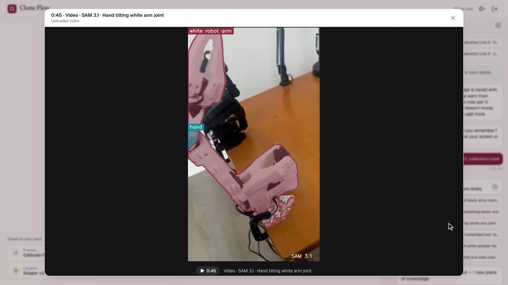
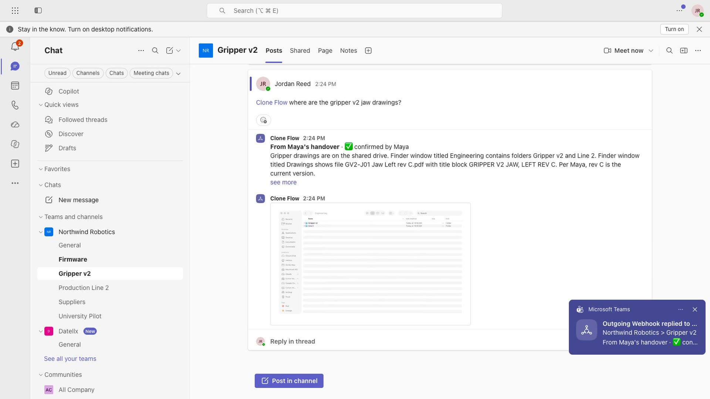
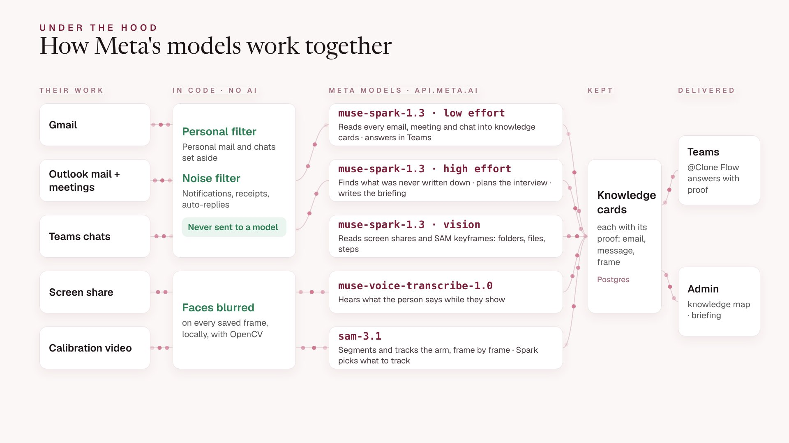

# Clone Flow

**When people leave, their knowledge stays.**

When someone leaves a company, what they know leaves with them: why a line is calibrated a certain way, who to call
when parts fail, where the right drawings are. Clone Flow captures that know-how in one guided conversation before
they go, and hands it to the next person right where they work, in Microsoft Teams.

▶ **3-minute demo video:** _link added at submission_ · **Live app:** https://cloneflow-engine.onrender.com

**Judges — try it live, no account needed.** On the [home page](https://cloneflow-engine.onrender.com):
- **Start the tour** — the Northwind Robotics workspace, view-only: Maya Lee's finished handover (knowledge map,
  every card with its proof, the SAM 3.1 calibration video, the successor briefing). Ask a question in **Ask**, the same
  engine that answers `@Clone Flow` in Teams.
- **Try it yourself** — a private workspace where *you* are the one leaving: tell it about your job, and it asks what
  only you know. Talk or type, share your screen, or upload a short video of a hands-on task.

| SAM 3.1 tracks a robot-arm calibration a person filmed | A successor asks `@Clone Flow` in Teams and gets the answer, with proof |
|---|---|
|  |  |

## Meta Global AI Hackathon 2026 — Submission Overview

- **Track & problem statement**: Startup (Datellx LLC) · Build for Your World
- **Hackathon provenance (Oct 26 – Nov 4, 2026)**: built 100% from scratch during the hackathon window. No code existed before Oct 26.
- **Meta AI runtime models** (all through the Meta Model API, `api.meta.ai`):
  - `muse-spark-1.3` — low reasoning effort reads email, meetings and chats into knowledge cards and answers in Teams; high effort finds the gaps, plans the interview and writes the briefing; vision reads screen shares, photos and video keyframes, and picks what SAM should track
  - `muse-voice-transcribe-1.0` — hears what the person says while they talk or show something
  - `sam-3.1` — segments and tracks the physical task in uploaded videos (shown on a real SO-101 robot-arm calibration)
- **Bonus category targeted**: Best Agentic Use-Case (multi-step: read → find gaps → interview → answer with proof)
- **Benchmarks**: see [Benchmarks](#benchmarks-live-product-nov-23-2026) below



## Quickstart

```bash
git clone https://github.com/Datellx/CloneFlow && cd CloneFlow
cp .env.example .env.local      # set MODEL_API_KEY to your Meta Model API key
./run.sh                        # installs, builds the web app, serves http://localhost:8000
.venv/bin/python -m pytest -q   # 11 tests, offline
```

**No key?** Leave `MODEL_API_KEY` empty: Clone Flow starts with an offline stand-in for the models (no network,
no cost), so the whole flow — setup, invitation, interview, knowledge pack, Ask — can be clicked through locally.
Answers are then simple heuristics, not Muse. The test suite runs the same way.

## What it is

Clone Flow is a web application for companies. When an employee gives notice, the company admin invites them to
one private conversation with Clone Flow. Clone Flow reads their work email, chats, files and repositories (personal
messages are set aside before any AI step), works out what was never written down, and asks only about that. The
person can talk, type, share their screen, upload documents and videos, or walk the floor with their phone. What
they know becomes the organization's knowledge base, which anyone can ask, with proof, on the web or in Microsoft
Teams (`@Clone Flow where are the spare servo horns?`).

Built by Datellx LLC on Meta's Muse models.

## How it works

1. **The admin creates the organization** and talks with the setup assistant for two minutes: what the company
   does, which knowledge it fears losing, which teams hold it, which tools people use. Clone Flow shapes the console
   around the answers, and every later AI step uses this context. People can be invited from the same chat.
2. **The person leaving opens their invitation link** and has one conversation with an animated interviewer:
   - connect **Microsoft 365** (Outlook, Teams, OneDrive), **Gmail** or **GitHub**, or skip and show instead;
   - Clone Flow separates personal from work in code, reads the work once, and turns it into knowledge cards with
     sources (processes, contacts, decisions, routines, open tasks, locations);
   - it asks about the gaps it found: a routine with no "why", two sources that disagree, an unfinished task, a
     step nobody wrote down, a supplier with no contact;
   - screen recordings, videos, photos and the phone floor walk go through computer vision: key frames are picked
     on scene change, faces are blurred locally, and one vision call turns them into steps and locations.
3. **The admin owns the knowledge base**: every person's pack, a knowledge map of who holds what, the questions
   nobody could answer, and **Ask** — answers come only from captured knowledge, cite their source, and say
   "I don't know" (naming who might) instead of guessing. Connect it to a Teams channel with an outgoing webhook.

## Plans

| Plan | People leaving | |
|---|---|---|
| Starter | 3 | Free |
| Growth | 25 | Contact us |
| Pro | 100 | Contact us |

Every organization also has an AI allowance on the free trial (`ORG_AI_CAP_USD`, $2 by default); past it, model
calls stop with a clear message and Ask keeps answering from the cards for free.

## AI: Meta Muse

All model calls go through one module, [`backend/knowledge/ai.py`](backend/knowledge/ai.py), using the Meta Model API:

| Step | Model | When |
|---|---|---|
| Setup conversation, interview answers, Ask | `muse-spark-1.3`, low reasoning effort | one small call per turn |
| Reading email/chat/files into cards | `muse-spark-1.3`, low effort | batched, ~9k characters per call |
| Planning the interview, takeover briefing | `muse-spark-1.3`, high effort | once per handover |
| Screen share, video, phone walk, photos | `muse-spark-1.3` vision | one call per clip |
| Voice answers | `muse-voice-transcribe-1.0` | per recording |
| Uploaded videos of physical work | `sam-3.1` (video segmentation + tracking), then `muse-spark-1.3` vision on the marked-up keyframes | one upload per video, up to 3 concepts |

Spending is deliberate: noise, newsletters, duplicates, recurring reminders and personal mail are removed in code
before anything reaches the model; retrieval and "I don't know" decisions use local embeddings
(`bge-small-en-v1.5`, on the server); repeated questions are cached.

## Benchmarks (live product, Nov 2–3, 2026)

Measured on a full handover (Maya, a robotics engineer, five years of Gmail, Outlook mail and meetings, and Teams):

| Metric | Result |
|---|---|
| Messages read in one pass | 394 emails and meetings + 232 Teams messages |
| Personal emails kept away from the model (code filter) | 9 of 9; 0 work emails wrongly removed |
| Teams answer latency, 10 live questions | median 4.0 s, p90 5.0 s; "I don't know" in 0.6 s with no model call |
| SAM 3.1 on a 92 s phone video of an SO-101 calibration | 742 frames tracked in 87 s on the live server (arm + hand, picked by Muse Spark vision from the narration) |
| Muse API cost of the whole handover (per-call log) | $0.93; about $0.004 per answer |
| Automated tests | 11 / 11 pass (`pytest -q`) |


## Privacy

- Personal messages are recognised in code (personal domains, family, health, finance and shopping cues) and stored
  as "set aside": never sent to a model, never shown to the company. The person can see exactly what was set aside.
- Passwords, keys, card, account and ID numbers are redacted before any model call.
- Faces are blurred in frames before vision. Connections are read-only and tokens are encrypted at rest.
- A departing employee sees only their own conversation; colleagues can ask but not browse; only admins see the
  knowledge base. See [docs/privacy.md](docs/privacy.md).

## Run it locally

Requirements: Python 3.11+ and Node 20+ (ffmpeg is bundled through `imageio-ffmpeg`; a system ffmpeg is used when present).

```bash
cp .env.example .env.local        # add MODEL_API_KEY (Meta Model API); without it an offline model is used
./run.sh                          # installs, builds the web app, starts http://localhost:8000
```

Development with hot reload: `uvicorn backend.app.main:app --reload` and `cd frontend && npm run dev`
(http://localhost:5173, proxies `/api` to port 8000).

## Tests

```bash
python -m pytest -q               # backend, offline model (no network, no cost)
cd frontend && npm run build      # type-check and build the web app
node e2e/web_flow.mjs http://localhost:8000 /tmp/shots   # browser walk-through (Playwright), laptop + phone
```

## Deploy

One service on **Render** builds the website and runs the engine that serves it and the API (`Dockerfile`,
`render.yaml`, persistent disk for uploads). **Supabase** provides sign-in (verified emails, password resets,
invitation emails) and the Postgres database. Desktop apps for Mac and Windows are built by GitHub
Actions (`.github/workflows/desktop.yml`). Step by step: [docs/DEPLOY.md](docs/DEPLOY.md).

## Repository

```
backend/
  app/          FastAPI app: config, auth, plans, routes (account, setup, handover, knowledge)
  onboarding/   setup assistant and invitations
  handover/     the departing employee's conversation, Microsoft 365 / Gmail / GitHub connectors, Teams webhook
  knowledge/    reading sources, personal vs work, cards, interview, phone walk, Ask, the Muse client
  media/        video key frames, face blur, audio
  db/           SQLAlchemy models (Supabase Postgres in production, SQLite for development)
frontend/src/
  site/         marketing pages, sign-up, sign-in, invitation
  app/          setup assistant, the handover conversation, the admin console
  shared/       interviewer orb, voice, source viewers, phone walk page
desktop/        Electron app (a window around the website, deep links, screen capture)
docs/           architecture, API, privacy, deployment
tests/          pytest suite with a small fixture mailbox
e2e/            Playwright browser walk-through
```

© 2026 Datellx LLC. All rights reserved.

## License

Apache License 2.0 — see [LICENSE](LICENSE). © 2026 Datellx LLC.
